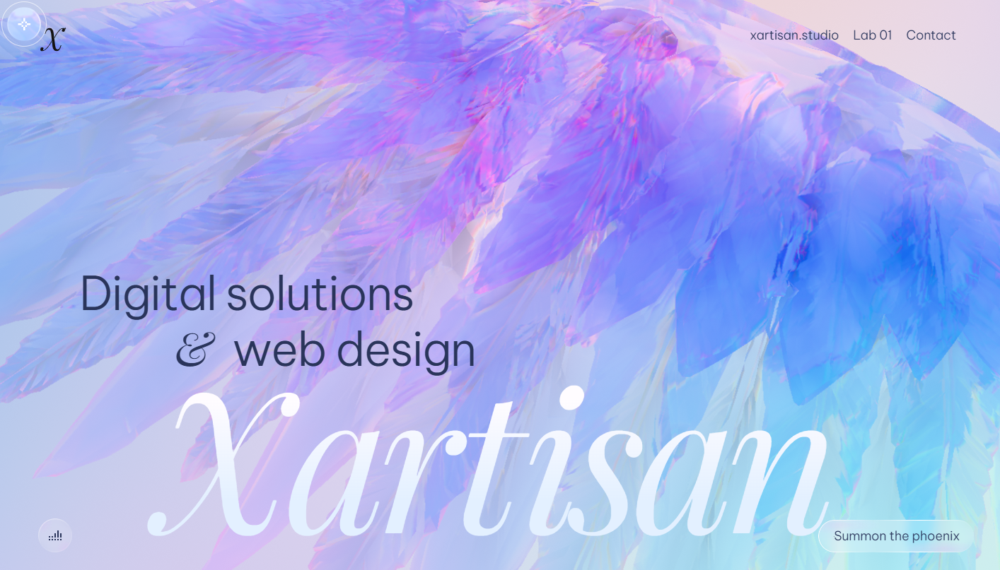
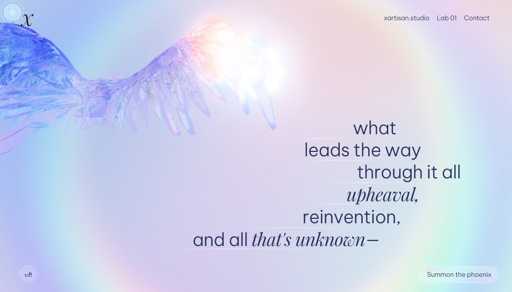
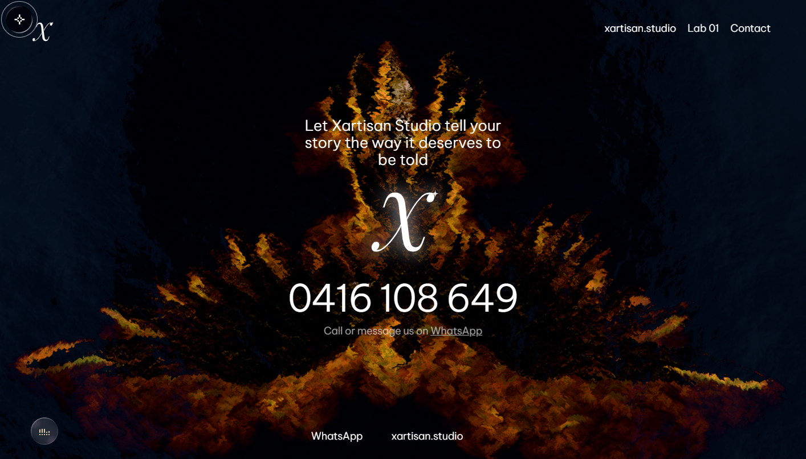
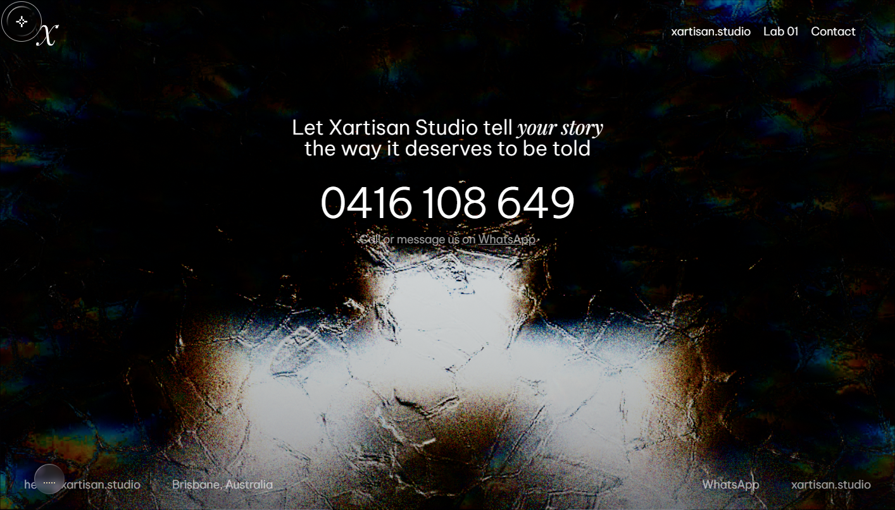
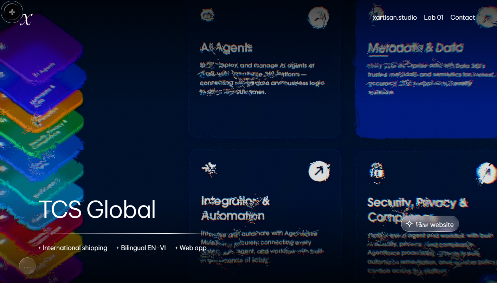
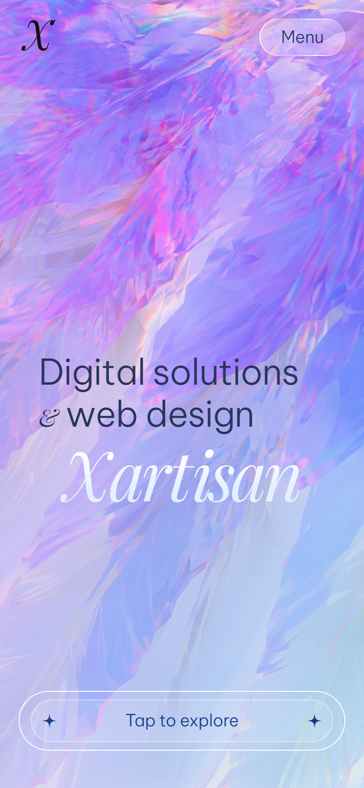
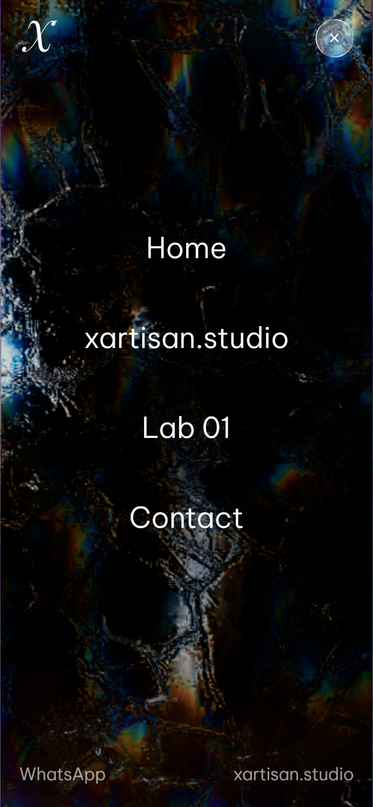

# Xartisan Studio — WebGL brand experience

A scroll-driven 3D story for **Xartisan Studio** (Brisbane, Australia). One continuous WebGL scene, twenty scroll chapters, seven case studies — delivered as a fully static site.




## What this is

The site is a single-page experience: a crystal phoenix assembles, shatters, burns and reforms as you scroll, carrying the studio's pitch, process and selected work. Every chapter is keyed to scroll position, so the visitor drives the story rather than watching it.

It is a **static build** — plain HTML, JS, CSS and media in `site/`. There is no server, no database, no API keys and no CDN accounts. Upload the folder to any static host and it runs.

### Highlights

- **Scroll choreography** — 20 sections stitched into one camera and scene timeline, with a progress rail, split-flap chapter intros and kinetic type.
- **Real-time 3D** — a 4.3 MB hero model, seven floating crystal meshes, Draco-compressed geometry, sprite trails and custom shaders rendered with three.js.
- **Sound design** — ambient score plus interaction cues, muted until the visitor opts in via the speaker toggle.
- **Seven case-study routes** — long-form project pages with looping video at `/cases/<slug>/`.
- **Responsive** — a dedicated mobile gate ("Tap to explore"), a full-screen menu and touch handling for the 3D scene.
- **Self-hosted assets** — fonts, models, textures, audio and video all ship in the repository; nothing is fetched from third parties at runtime.
- **Clean URLs** — routes resolve as `/<page>/index.html`, which every static host serves natively.

## Screens

| Chapter | Finish |
| --- | --- |
|  |  |
|  |  |

<p align="center">
  
  
</p>

## Run it locally

Requires Node 18+; the live site itself needs no install step or build:

```bash
npm run serve      # http://127.0.0.1:4173
```

Open the URL, click **Click to start** (**Tap to explore** on a phone) and scroll. WebGL must be enabled in the browser.

`tools/server.mjs` is a dependency-free static server: clean URLs, correct MIME types for `.glb`, `.ktx2` and `.woff2`, and CORS headers for local testing.

## Deploy

`site/` is the publish root. Drop it at the root of any static host — Cloudflare Pages, Netlify, Vercel, S3 + CloudFront, nginx — and point the domain at it.

- Asset paths are root-absolute (`/_nuxt/…`), so the site must live at `/`, not in a subdirectory.
- Long-cache `/_nuxt/*` (hashed filenames) and `models/`, `textures/`, `videos/`, `audio/`; keep HTML short-lived.
- Total payload is ~47 MB, dominated by the 4.3 MB hero model and ~11 MB of case-study video. Media loads progressively, chapter by chapter.

## Project structure

```
site/                 deployable build (the whole site)
  index.html          the scroll experience
  contacts/           contact page
  cases/<slug>/       seven case-study pages
  _nuxt/              compiled JS + CSS bundles, woff2 fonts
  models/             GLB crystal + phoenix meshes
  textures/           scene and crystal maps
  videos/             case-study loops
  audio/              score + interaction cues
  images/, libs/      brand marks, icons, Draco decoder
preview/              screenshots used in this README
tools/
  server.mjs          static server (clean URLs, MIME, CORS)
  make-brand.mjs      generates the X wordmark from Playfair Display Italic
  make-images.mjs     renders og:image + favicon in headless Chromium
  check-pages.mjs     headless route check: console errors, 4xx, screenshots
  test-case-click.mjs regression test for the project-card interaction
  tour.mjs, mobile.mjs  capture tooling for the preview set
  cdp.mjs             minimal Chrome DevTools Protocol client
```

## Tooling

The QA scripts drive a headless Chromium/Edge instance over CDP:

```bash
# start a browser with --remote-debugging-port=9333, then:
npm run check                       # visit four routes, report console + network errors
npm run test:click                  # assert project cards do not navigate
```

They connect to `127.0.0.1:9333` by default (`CDP_PORT` overrides) and write screenshots to `inspect/`.

`npm run build` regenerates the brand assets in `site/images/svg/`, `site/OG.png` and the favicon; it needs `node_modules` (`npm install`) and a headless browser on the same CDP port.

## Browser support

Built and tested against Chromium, desktop and mobile emulation. The scene needs WebGL — it is GPU-heavy by design, and there is no non-WebGL fallback for the 3D layer.

## Licensing

Tooling and copy in `tools/` and `content/` are © Xartisan Studio. Typefaces are used under the SIL Open Font License (Be Vietnam Pro, Playfair Display). The 3D scene, models, textures, video and audio bundled in `site/` remain the property of their respective rights holders and are included for demonstration purposes only.
